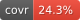

<!-- README.md is generated from README.Rmd. Please edit that file -->

```{r, include = FALSE}
knitr::opts_chunk$set(
  collapse = TRUE,
  comment = "#>",
  fig.path = "man/figures/README-",
  out.width = "100%"
)
```

# zuroar

<!-- badges: start -->
[](https://lifecycle.r-lib.org/articles/stages.html#experimental)
[](https://github.com/pedrobtz/zuroar/actions/workflows/R-CMD-check.yaml)
[](https://github.com/pedrobtz/zuroar/actions/workflows/coverage.yaml)
<!-- badges: end -->

Large sets of whole numbers are everywhere: the ids of users who did
something, the rows that pass a filter, the documents that contain a word.
In R they are usually integer vectors, which cost four or eight bytes a
value and are hashed or sorted again for every `union()` or `%in%`.

zuroar keeps such sets compressed, as
[Roaring bitmaps](https://roaringbitmap.org/), through a bundled copy of
[CRoaring](https://github.com/RoaringBitmap/CRoaring), the reference C
implementation.

* **Compressed.** Each chunk of 65,536 values is stored
  as a sorted array, a bitset or a list of runs, whichever is smallest,
  and set operations work on those containers directly.
* **Exact.** A bitmap holds whole numbers from 0 to 2^32 - 1, or up to
  2^64 - 1 with `roar64()`. Nothing is silently turned into `NA` or an
  inexact double: a value that does not fit is an error.
* **A sorted vector to R code.** `length()`, `x[i]`, `head()`, `min()`,
  `%in%` and `c()` behave as they would on `sort(unique(v))`, while the
  values stay compressed. A bitmap survives `saveRDS()`, travels to
  parallel workers and fits in a data-frame column.
* **Ordered questions.** Rank, select, and the next or previous value
  are answered without expanding the set.
* **A shared format.** Bitmaps serialise to the portable Roaring format
  that Java, Go, Rust and Python implementations read and write, and
  untrusted bytes are checked before they are used.

## Installation

zuroar is not on CRAN yet. Install the development version from GitHub:

``` r
# install.packages("pak")
pak::pak("pedrobtz/zuroar")
```

CRoaring compiles AVX2 and AVX-512 code paths and picks one at run time,
so the same build runs on any x86-64 or arm64 processor;
`zuroar_info()` says which paths were compiled and which this processor
offers. To build the portable scalar code only, add this line to
`~/.R/Makevars` before installing:

``` make
CPPFLAGS += -DROARING_DISABLE_X64
```

## Usage

```{r, message = FALSE}
library(zuroar)
```

Say we have the ids of the users who visited a site on two days.
`roar()` builds a bitmap from whole numbers in any order, with or without
duplicates, and prints its size, range and first values.

```{r}
monday <- roar(c(17, 3, 4096, 3, 70000, 2^31))
tuesday <- roar_add(roar_range(1, 20), 70000)
monday
tuesday
```

Set operations are operators: `&` is the intersection, `|` the union and
`<=` the subset test. Counts need no intermediate bitmap.

```{r}
monday & tuesday
monday | tuesday
roar(c(3, 17)) <= monday
roar_cardinality(monday, tuesday, op = "or")
```

A bitmap answers membership and order questions directly: which values
it holds, how many are at or below a number, which is the third smallest,
and which comes next.

```{r}
roar_contains(monday, c(17, 18))
roar_rank(monday, 4096)
monday[[3]]
roar_next(monday, 5000)
```

Contiguous stretches are stored as runs, so a million values take a few
hundred bytes. `roar_size()` is the size of the portable byte form that
`roar_serialize()` writes and other Roaring libraries read.

```{r}
everyone <- roar_range(1, 1e6)
length(everyone)
roar_size(everyone)
b <- roar_serialize(monday)
roar_unserialize(b) == monday
```

Functions that take or return bitmaps start with `roar_`; those that
exist only for the 64-bit class start with `roar64_`.

## Learn more

* [Get started](https://pedrobtz.github.io/zuroar/articles/zuroar.html)
  walks through building, querying, combining and saving bitmaps.
* [Benchmarks](https://pedrobtz.github.io/zuroar/articles/benchmarks.html)
  measures time and memory against base R and the bit package.
* The [reference index](https://pedrobtz.github.io/zuroar/reference/)
  documents every function.

## Related work

zuroar wraps [CRoaring](https://github.com/RoaringBitmap/CRoaring) 5.4.0
and follows the
[Roaring format specification](https://github.com/RoaringBitmap/RoaringFormatSpec).
Its API was checked against [pyroaring](https://github.com/Ezibenroc/PyRoaringBitMap),
and its tests read bytes written by pyroaring and Java's
[RoaringBitmap](https://github.com/RoaringBitmap/RoaringBitmap). The
[bit](https://cran.r-project.org/package=bit) package is the better
choice for a boolean vector of known length.
